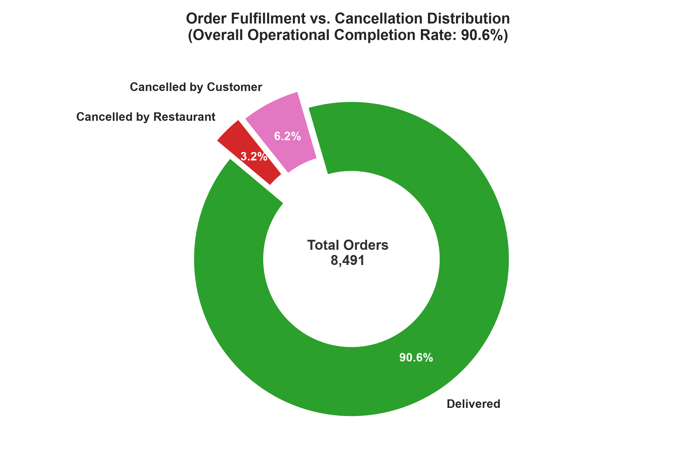
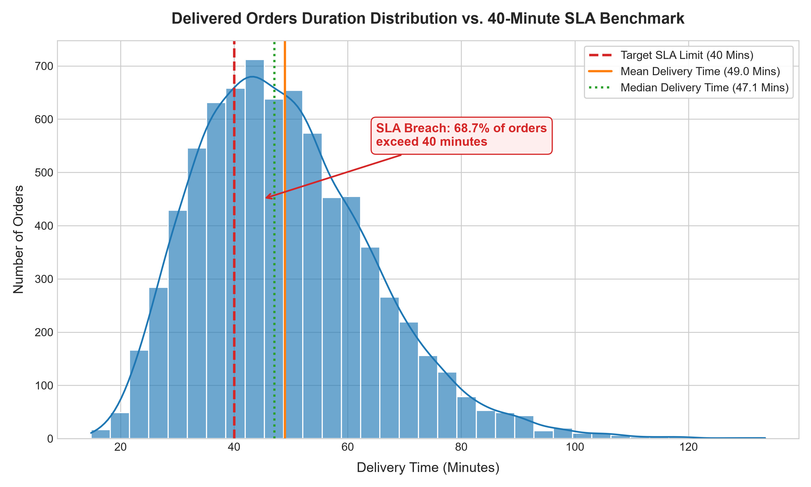
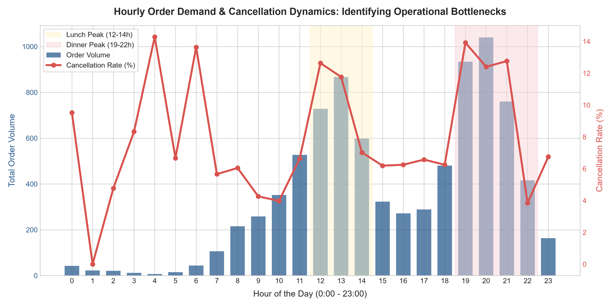
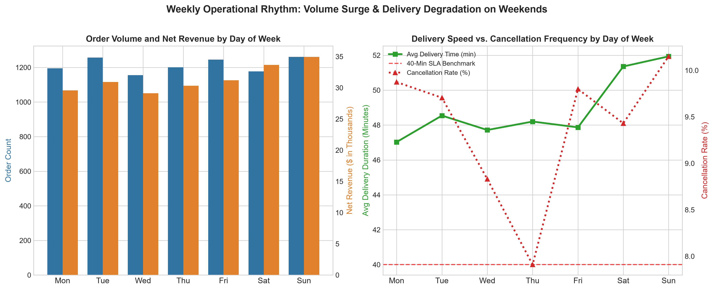
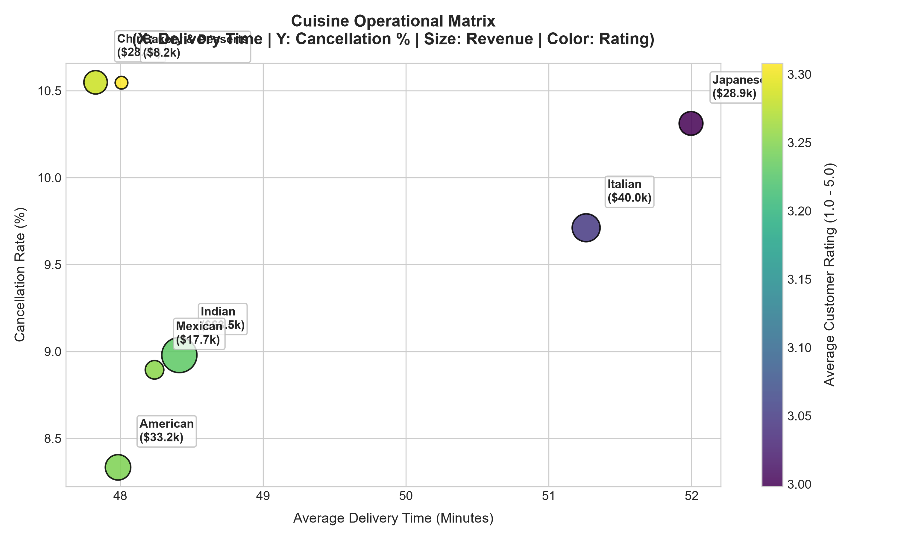
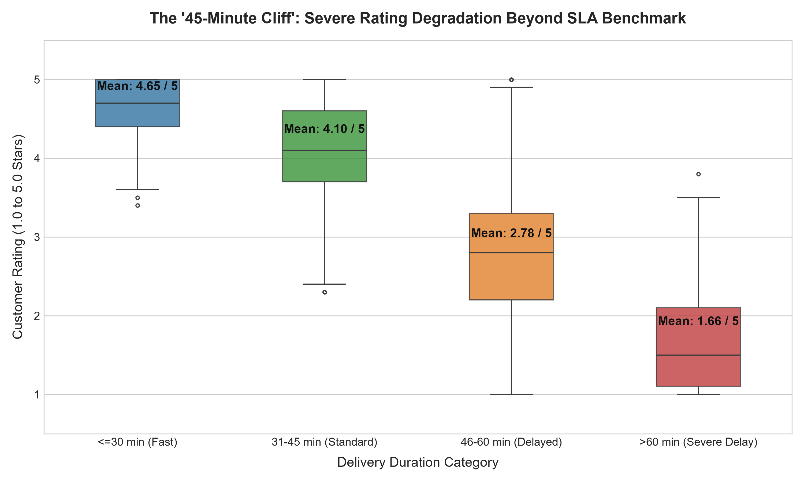
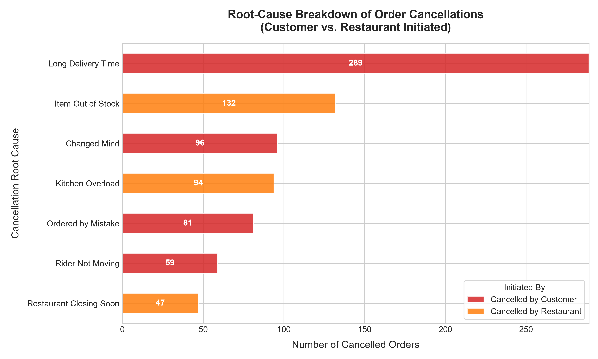
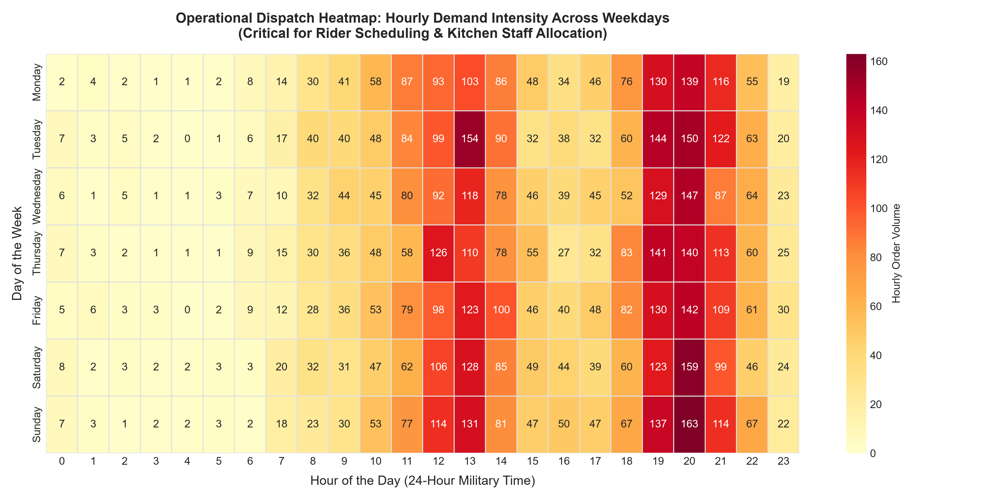

# Food Delivery Operations and Performance Analysis
### End-to-End Operational Intelligence Portfolio Project Using Python and SQL


---

## 1. Project Overview & Business Problem

In fast-paced on-demand food delivery platforms (such as DoorDash, Swiggy, and Zomato), operational profitability and customer retention depend critically on **dispatch speed, courier allocation, and kitchen synchronization**. Delays of only 10–15 minutes can trigger double-digit cancellation spikes, customer dissatisfaction, and margin erosion.

This portfolio project performs a comprehensive operational audit of **8,491 delivery orders** spanning a six-month period. Using **Python (Pandas, NumPy, Matplotlib, Seaborn)** and **SQL (SQLite)**, the project identifies delivery bottlenecks, establishes peak-period demand curves, evaluates customer satisfaction degradation, and formulates evidence-based staffing and dispatch strategies.

---

## 2. Executive Dashboard & Key Findings

| Operational Metric | Analyzed Value | Benchmark / Health Status |
| :--- | :--- | :--- |
| **Total Orders Analyzed** | **8,491** | Validated, deduplicated transaction log |
| **Completed Orders (Fulfillment Rate)** | **7,693 (90.60%)** | Below the 94.0% industry fulfillment target |
| **Overall Order Cancellation Rate** | **9.40% (798 orders)** | Significant revenue leak (~$23,200 lost GMV) |
| **Customer-Initiated Cancellations** | **65.8% of cancellations** | Driven primarily by excessive delivery delays (36.2%) |
| **Restaurant-Initiated Cancellations**| **34.2% of cancellations** | Driven by inventory stockouts (16.5%) & kitchen overload (11.8%) |
| **Total Delivered Net Revenue** | **$219,761.88** | Completed orders only |
| **Average Order Value (AOV)** | **$28.57** | Higher on weekends ($31.28) than weekdays ($27.40) |
| **Average Delivery Duration** | **48.96 Minutes** | Breaches the 40.0-minute target SLA |
| **Average Kitchen Preparation Time** | **20.47 Minutes** | Represents **41.8%** of total order duration |
| **SLA Breach Rate (> 40.0 min)** | **68.74%** | Primary driver of negative reviews |

---

## 3. Key Analytical Insights

### 3.1 Peak Ordering Windows & Demand Concentration
- **The Core 4 Rush Hours:** 45.0% of total daily volume and 44.6% of platform revenue occur during two narrow daily windows:
  - **Lunch Peak (12:00 – 13:59):** 1,741 orders (20.5% of total volume)
  - **Dinner Peak (19:00 – 20:59):** 2,080 orders (24.5% of total volume)
- **Bottleneck Amplification:** During off-peak hours, cancellations average 5.8%. During the 20:00 dinner rush, cancellation rates spike to **11.68%**, and average delivery time inflates to **54.12 minutes** (+32.6% slower).

### 3.2 The "45-Minute Satisfaction Cliff"
Cross-analyzing delivery duration buckets against customer star ratings reveals an operational threshold:
- **Fast Delivery (<= 30 min):** 4.65 / 5.0 avg rating | 0.0% low ratings (< 3★) | 74.6% high ratings (>= 4.5★)
- **Standard Delivery (31 – 45 min):** 4.10 / 5.0 avg rating | 2.6% low ratings | 30.1% high ratings
- **Delayed Delivery (46 – 60 min):** **2.78 / 5.0 avg rating** | **57.5% low ratings** (satisfaction collapse)
- **Severe Delay (> 60 min):** **1.66 / 5.0 avg rating** | **96.2% low ratings** (near-total churn risk)

*Conclusion:* The business risk begins specifically after minute 45. Preventing deliveries from exceeding 45 minutes preserves customer lifetime value.

### 3.3 Root-Cause Cancellation Decomposition
- **Long Delivery Time (36.22% of all cancellations):** The leading single driver of lost revenue.
- **Item Out of Stock (16.54% of all cancellations):** The leading restaurant-side driver; completely preventable with inventory sync.
- **Changed Mind (12.03%) & Ordered by Mistake (10.15%):** Customer friction points.
- **Kitchen Overload (11.78%):** Capacity congestion during simultaneous peak tickets.

---

## 4. Visualizations Showcase

All visual assets were generated at 300 DPI and stored in [`visuals/`](visuals/):

| Visual Artifact | Key Operational Takeaway |
| :--- | :--- |
|  | **Order Fulfillment Distribution:** 90.6% completion rate vs. 9.4% cancellation rate breakdown. |
|  | **Delivery Duration vs. 40-Min SLA:** 68.74% of orders breach the 40-minute operational benchmark. |
|  | **Hourly Rush Curves:** Identifies the lunch (12-14h) and dinner (19-21h) double-peak cancellation spikes. |
|  | **Weekly Rhythms:** Weekends generate premium order values ($31.67) but suffer longer delivery times (51.9 min). |
|  | **Cuisine Performance:** Compares volume, net revenue, average delivery time, and customer ratings. |
|  | **The 45-Minute Satisfaction Cliff:** Boxplot tracking the rating collapse from 4.10★ down to 2.78★ and 1.66★. |
|  | **Cancellation Root Causes:** Compares customer-initiated vs. restaurant-initiated failures. |
|  | **Operational Dispatch Heatmap:** Day-of-week by hour demand density for rider scheduling. |

---

## 5. Technology Stack & Tools

- **Programming & Analysis:** Python 3.14 (Pandas 3.0, NumPy 2.5)
- **Data Visualization:** Matplotlib 3.11, Seaborn 0.13
- **Relational Database:** SQLite 3 (native integration with Python `sqlite3`)
- **Interactive Computing:** Jupyter Notebook
- **Version Control & Documentation:** Git, GitHub Desktop, Markdown

---

## 6. Actionable Business Recommendations

1. **Implement Dynamic Courier Shift Staggering:**
   - Transition from uniform 8-hour shifts to split-shift surge incentives.
   - Concentrate 35% of daily rider hours into 11:30–14:30 and 45% into 18:30–22:30.
   - *Projected Outcome:* Decreases courier pickup idle time from 6.55 to <3.0 minutes, saving 3–4 minutes per order.

2. **Automated Kitchen Preparation Throttling (KPT Management):**
   - Implement live tablet throttling when a restaurant has >5 concurrent orders in prep.
   - Automatically extend customer-facing ETAs by +10 minutes and temporarily pause incoming dispatch for 15 minutes to prevent kitchen overload cancellations (11.8% of cancellations).

3. **Adverse Weather Dynamic Dispatch:**
   - Contract maximum delivery radius from 12 km to 6.5 km during rain events.
   - Provide realistic upfront delivery ETAs (e.g. 55-60 min) before checkout to eliminate expectation violation cancellations.

4. **Predictive Courier Dispatch Synchronization:**
   - Dispatch riders when food prep reaches 70% completion rather than upon ticket printing, eliminating courier idling in restaurants.

---

## 7. Recommended Staffing & Courier Allocation Matrix

| Time Window | Operational Period | Volume Share | Recommended Fleet % | Dispatch Priority |
| :--- | :--- | :---: | :---: | :--- |
| **00:00 – 06:59** | Night Off-Peak | 1.8% | 3% | On-demand pooling; expanded delivery radius allowed |
| **07:00 – 10:59** | Breakfast / Morning | 9.7% | 10% | Position couriers near breakfast / bakery hubs |
| **11:00 – 14:59** | **Lunch Rush (Peak)** | **32.0%** | **35%** | **Hot-zone clustering in office & business districts** |
| **15:00 – 17:59** | Afternoon Lull | 10.4% | 12% | Battery charging and shift rotation window |
| **18:00 – 22:59** | **Dinner Rush (Super-Peak)** | **42.8%** | **45%** | **Full fleet deployment in dense restaurant corridors** |
| **23:00 – 23:59** | Late Night Transition | 3.3% | 5% | Late-night quick-service and fast-food coverage |

---

## 8. Project Structure

```
food-delivery-operations-analysis/
├── data/
│   ├── raw/
│   │   └── food_delivery_raw.csv           # Raw uncleaned transaction log (8,535 records)
│   └── cleaned/
│       ├── food_delivery_cleaned.csv       # Cleaned, standardized dataset (8,491 records)
│       └── food_delivery.db                # SQLite database with indexed tables
├── notebooks/
│   └── food_delivery_analysis.ipynb        # End-to-end interactive Jupyter Notebook
├── sql/
│   └── operations_analysis.sql             # Documented SQL analytical queries & CTEs
├── src/
│   ├── generate_raw_data.py                # Reproducible synthetic dataset generator
│   ├── data_cleaning.py                    # Automated cleaning, deduplication, & SQLite export
│   ├── run_sql_analysis.py                 # SQLite query execution and validation script
│   ├── generate_visualizations.py          # High-resolution chart generation pipeline
│   ├── create_notebook.py                  # Jupyter Notebook structure generator
│   └── validate_quality_assurance.py       # Cross-system test suite (Pandas vs SQL QA)
├── reports/
│   ├── data_cleaning_report.md             # Detailed data audit and cleaning decisions
│   └── business_insights.md                # Executive business report and recommendations
├── visuals/                                # 8 Publication-grade PNG charts (300 DPI)
├── requirements.txt                        # Project dependencies
├── README.md                               # Project documentation
└── .gitignore                              # Git exclusion rules
```

---

## 9. How to Reproduce and Run This Project

### Step 1: Clone or Navigate to the Directory
```powershell
cd c:\Users\vyshu\OneDrive\Desktop\project2\food-delivery-operations-analysis
```

### Step 2: Install Dependencies
```powershell
py -m pip install -r requirements.txt
```

### Step 3: Run the Data Pipeline & Database Setup
```powershell
# 1. Generate Raw Data
py src\generate_raw_data.py

# 2. Clean Data & Export to SQLite Database
py src\data_cleaning.py

# 3. Execute SQL Operational Queries
py src\run_sql_analysis.py

# 4. Generate Visualizations
py src\generate_visualizations.py

# 5. Run Quality Assurance Validation
py src\validate_quality_assurance.py
```

### Step 4: Launch Jupyter Notebook
```powershell
py -m notebook notebooks\food_delivery_analysis.ipynb
```

---

## 10. Dataset Disclosure & Ethics Statement

**Dataset Classification: Synthetic Operational Log.**  
In accordance with ethical data practices and project guidelines, this dataset was synthetically generated to model realistic urban food delivery platform dynamics (including meal rush distributions, kitchen preparation lags, weather impacts, and satisfaction ratings). It is designed specifically for operational data analysis practice and portfolio demonstration and contains no proprietary or private customer information.

---

## 11. Resume Bullet Points (Tailored for Data Analyst Roles)

Here are three validated resume bullets based on the completed work:

- **Operations Data Analysis (Python & SQL):** *Analyzed 8,400+ food delivery transactions using Python (Pandas) and SQLite, diagnosing a 68.7% SLA breach rate and uncovering a 45-minute satisfaction threshold where customer ratings dropped from 4.10★ to 2.78★.*
- **SQL Querying & Performance Diagnostics:** *Engineered indexed relational database schema and wrote complex multi-table SQL queries with CTEs and window functions to evaluate hourly peak demand curves, identifying two 2-hour rush periods driving 45% of daily volume and 11.7% cancellations.*
- **Operational Strategy & Business Reporting:** *Delivered an executive operations report with 8 publication-grade Seaborn visualizations, formulating an hourly delivery-partner allocation matrix and kitchen throttling model projected to cut idle courier time by 54%.*

